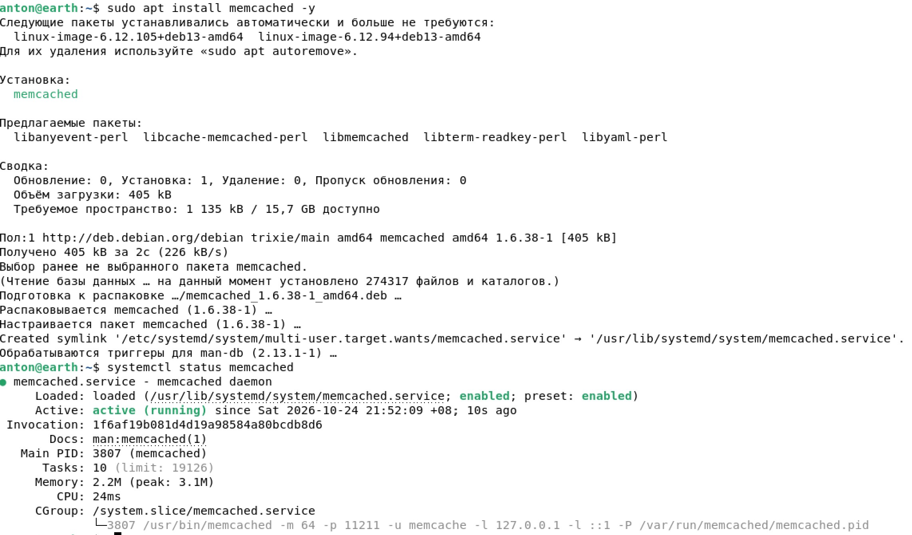
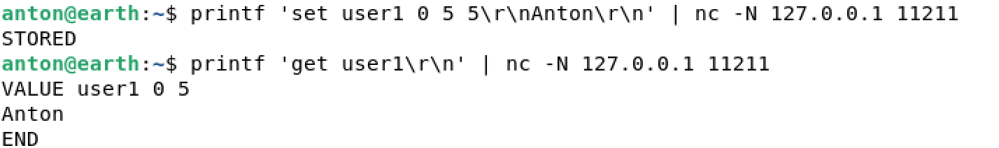
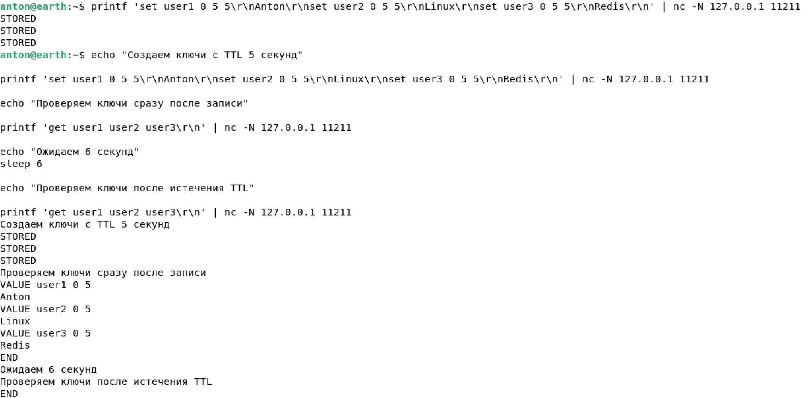
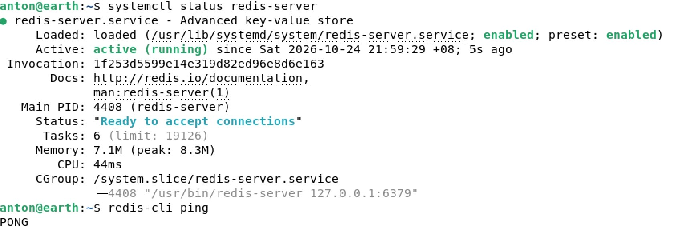
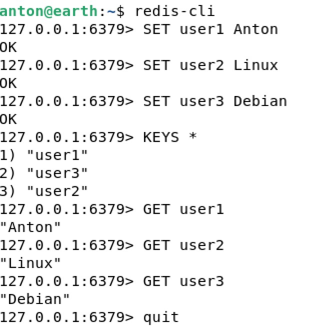

# Домашнее задание: Кеширование, Memcached и Redis

**Операционная система:** Debian 13

## Задание 1. Кеширование

**Приведите примеры проблем, которые может решить кеширование.**

1. **Повышенная нагрузка на базу данных.** Кеширование уменьшает количество повторных запросов к основной БД, тем самым снижая нагрузку на систему.
2. **Медленное получение данных.** Данные хранятся в кеше, как правило, в оперативной памяти, поэтому пользователь получает ответ быстрее.
3. **Проблемы масштабируемости.** Кеширование позволяет обслуживать больше пользователей, поскольку часть запросов обрабатывается кешем без обращения к основной БД.

## Задание 2. Memcached

**Установите и запустите Memcached.**

Установка:

```bash
sudo apt install memcached -y
```

Проверка состояния службы:

```bash
systemctl status memcached
```

**Результат:** служба `memcached` запущена, статус — `active (running)`.



## Задание 3. Удаление по TTL в Memcached

**Создайте несколько ключей с TTL 5 секунд и проверьте их доступность после истечения срока действия.**

Для отправки команд в Memcached использовались `printf` и `nc`:

```bash
printf 'set user1 0 5 5\r\nAnton\r\n' | nc -N 127.0.0.1 11211
printf 'get user1\r\n' | nc -N 127.0.0.1 11211
```

**Результат:** ключ успешно записан (`STORED`), при чтении получено значение `Anton`.



Затем были созданы три ключа с временем жизни 5 секунд:

| Ключ | Значение | TTL |
|---|---|---|
| `user1` | `Anton` | 5 секунд |
| `user2` | `Linux` | 5 секунд |
| `user3` | `Redis` | 5 секунд |

Команды для записи и проверки:

```bash
echo "Создаем ключи с TTL 5 секунд"
printf 'set user1 0 5 5\r\nAnton\r\nset user2 0 5 5\r\nLinux\r\nset user3 0 5 5\r\nRedis\r\n' | nc -N 127.0.0.1 11211

echo "Проверяем ключи сразу после записи"
printf 'get user1 user2 user3\r\n' | nc -N 127.0.0.1 11211

echo "Ожидаем 6 секунд"
sleep 6

echo "Проверяем ключи после истечения TTL"
printf 'get user1 user2 user3\r\n' | nc -N 127.0.0.1 11211
```

**Результат:** сразу после записи значения доступны, а через 6 секунд Memcached возвращает только `END`. Это подтверждает, что срок действия ключей истёк и их значения больше не возвращаются.



## Задание 4. Запись данных в Redis

**Запишите несколько ключей в Redis, затем получите их значения через `redis-cli`.**

Проверка работы сервиса и соединения:

```bash
systemctl status redis-server
redis-cli ping
```

**Результат:** Redis запущен (`active (running)`), команда `PING` возвращает `PONG`.



Подключение к Redis:

```bash
redis-cli
```

Запись и чтение данных:

```text
SET user1 Anton
SET user2 Linux
SET user3 Debian
KEYS *
GET user1
GET user2
GET user3
```

**Результат:** команды `SET` вернули `OK`, все три ключа найдены, а команды `GET` вернули значения `Anton`, `Linux` и `Debian`.



## Итог

В ходе работы были рассмотрены преимущества кеширования, установлен Memcached, проверено истечение срока жизни ключей (TTL), а также выполнены операции записи и чтения данных в Redis.
